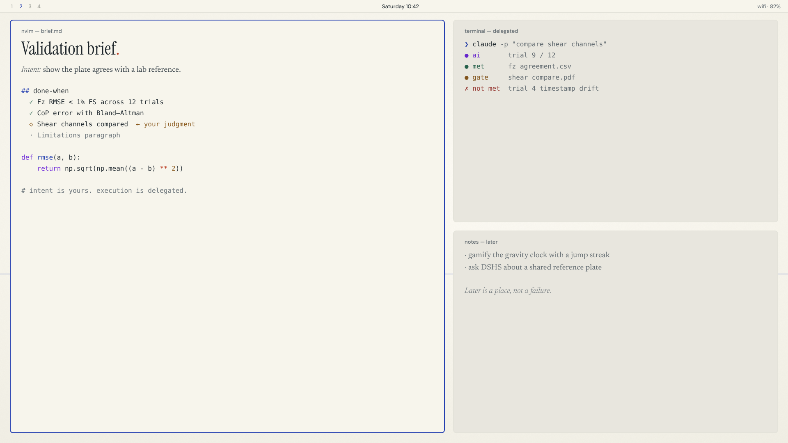

# TTheme

**TSurfing for Omarchy.** Warm paper, ink, and one meaning per color.



```bash
omarchy-theme-install https://github.com/mariusschober/TTheme
```

That gives you the palette, wallpapers and app themes. Omarchy drops `.lua` files from a theme installed from git, so it skips `hyprland.lua` (the ink focus border and the dimming of inactive windows). To keep it, clone elsewhere and symlink the folder in; Omarchy treats a symlinked theme as your own:

```bash
git clone https://github.com/mariusschober/TTheme ~/src/TTheme
ln -s ~/src/TTheme ~/.config/omarchy/themes/ttheme
omarchy theme set ttheme
```

For evenings there is **TTheme Dark** on the [`dark` branch](https://github.com/mariusschober/TTheme/tree/dark), with a watcher that switches between the two at sunrise and sunset.

## Why it looks like this

A desktop is an attention budget. Most themes spend it on decoration; TTheme spends it on one thing: showing you where you are and what needs you. For an ADHD mind the enemy is rarely effort. It is a dozen things shouting at the same volume. TTheme makes the volume unequal on purpose.

The ground is paper because paper is the oldest interface for thinking. It asks nothing of you. The focused window is drawn in ink; everything else stays paper and recedes slightly, so context stays one glance away without competing.

## One meaning per color

The palette is the TSurfing CI, and every color carries exactly one meaning in the terminal, the editor, the bar and the monitor alike.

| Color | Meaning |
|---|---|
| **Ink blue** `#243FB0` | You: human intent, the focused window, the next action |
| **Violet** `#6D28D9` | AI: delegated work, a machine's voice |
| **Green** `#28664F` | Met: a done-when line satisfied, work accepted |
| **Amber-brown** `#8A5A1E` | Gate: waiting for your judgment |
| **Red** `#A13E38` | Not met: real failures only, never ornament |
| **The dot** `#BC4127` | The period in "Tsurfing.", a sentence finished |

Red is the most rationed color. A theme that paints keywords red trains you to ignore red, and then the one real failure hides in plain sight. Violet stays quiet because watching a machine work is the task humans do worst: delegated work should be visible when you look and silent when you don't.

## Wallpapers for a conscious day

1. **Horizon**: a single ink line and the dot. The default focus field.
2. **One thing.**: the sentence every day should end with.
3. **Two gates**: the TSurfing loop as one line. Your intent, release, AI works, accept, done.
4. **Tide**: an engraved contour field rising to one crest. Momentum, drawn.
5. **Ledger**: the notebook, with one question.
6. **Ink**: the horizon at night, for evenings and dark rooms.

All are 3840×2160, set in the CI's own typefaces (Instrument Serif, Newsreader, DM Sans).

## Files

`colors.toml` is the single source of truth; Omarchy generates terminals, Neovim, VS Code, the bar, menus and notifications from it. `hyprland.lua` sets the ink focus border and gentle dimming of inactive windows (raise `dim_strength` for deep-work sessions). `btop.theme`, `chromium.theme`, `shell.lock.toml`, `icons.theme` and `keyboard.rgb` complete the set.
